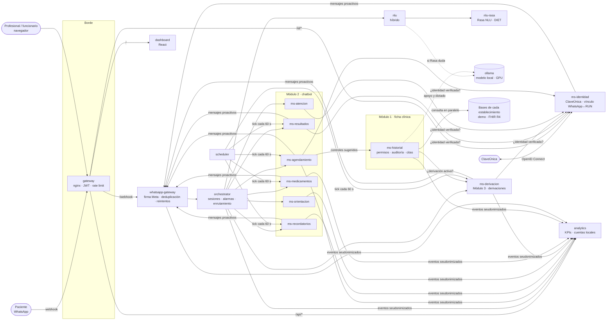
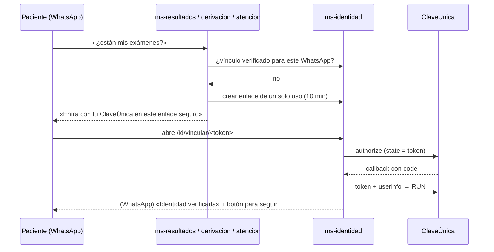

# Arquitectura de MedicAI

## Vista general



Solo el contenedor `gateway` publica un puerto. Todo lo demás vive en la red interna `backend`.

## Recorrido de un mensaje

1. Meta envía el webhook → nginx → `whatsapp-gateway`. Se verifica la firma `X-Hub-Signature-256`,
   se descarta si el `message_id` ya se procesó (Meta reintenta) y se responde 200 de inmediato.
2. En segundo plano el gateway llama a `orchestrator /message`.
3. El orquestador evalúa **señales de alarma** primero (palabras clave deterministas: dolor torácico,
   dificultad respiratoria, ideación suicida…). Si hay una, responde con 131 / \*4141 sin pasar por modelos.
4. Si el paciente tocó un botón, el prefijo del id (`agd:`, `rec:`, `ori:`, `der:`, `med:`) decide el
   servicio. Si escribió texto dentro de un trámite, el texto va a ese servicio. Si no, se consulta el NLU.
5. El microservicio responde con mensajes **independientes del canal**, su nuevo estado y eventos de
   dominio. El orquestador guarda el estado en Redis (TTL 30 min) y emite la telemetría.
6. El gateway traduce los mensajes al formato de WhatsApp (respetando límites de 3 botones, 10 filas,
   1.024 caracteres) y los envía con reintentos ante 429/5xx.

## Contrato entre orquestador y microservicios

`POST /dialog` en cada microservicio (definido en `libs/medicai_common/contracts.py`):

```jsonc
// DialogRequest
{ "user_id": "569…", "channel": "whatsapp", "text": "…", "option_id": "agd:center:las_americas",
  "intent": "agendar_cita", "entities": {"prestacion": "matrona"}, "state": {…}, "start": false }
// DialogResponse
{ "messages": [{"type": "list", "text": "…", "options": [{"id": "agd:slot:…", "title": "…"}]}],
  "state": {…} | null,            // null = trámite terminado
  "resolved": true,               // terminó sin intervención humana
  "events": [{"type": "appointment_booked", "center": "las_americas", "props": {…}}],
  "handoff": {"service": "recordatorios", "entities": {"medicamento": "Losartán"}} | null }
```

Los servicios no guardan sesiones (el estado viaja en el contrato), por lo que escalan
horizontalmente. Un servicio puede derivar al paciente a otro con `handoff` (p. ej. tras programar un
retiro en farmacia, ofrecer recordatorios de toma).

## NLU híbrido

| Capa | Cuándo actúa | Por qué |
|---|---|---|
| Detector de alarmas | Siempre, primero | Seguridad: no puede depender de la confianza de un modelo |
| Rasa NLU (DIET + n-gramas de caracteres) | Confianza ≥ `RASA_CONFIDENCE_THRESHOLD` (0,70) | Modelo propio, entrenado con español de Chile, sin costo por consulta, auditable |
| LLM (opcional) | Rasa duda | Cubre redacciones no vistas; elige de una lista cerrada de intenciones |
| Reglas por palabras clave | Rasa y LLM no disponibles | El sistema sigue operando en modo degradado |

Cada interacción registra qué capa resolvió, su confianza y su latencia: con eso se mide el aporte de
cada componente de IA (`scripts/evaluar_nlu.py` y gráfico «¿Quién interpretó los mensajes?»).

## Datos y privacidad (Ley 21.719)

- **Base por servicio.** Ningún servicio lee la base de otro.
- **Analítica seudonimizada.** `analytics` guarda un hash salado del teléfono, nunca el número ni el
  texto de los mensajes. Los eventos no incluyen nombres de medicamentos ni síntomas.
- **Modelo 100 % local.** Por defecto `ollama` dentro de la red. Un proveedor externo queda bloqueado salvo
  `LLM_ALLOW_EXTERNAL=true` y nunca recibe datos clínicos. Al NLU se le enmascaran RUT, teléfonos y correos.
- **Sin datos de identidad por el chat.** RUN, claves y pagos nunca se piden por WhatsApp; la identidad se
  verifica con ClaveÚnica (ver arriba).
- **Endpoints internos** (`/dialog`, `/internal/*`) bloqueados en el gateway y protegidos con
  `INTERNAL_TOKEN`; el dashboard exige JWT; el login tiene límite de intentos.

## Permisos del Módulo 1 (ficha clínica)

1. **Quién:** solo roles clínicos (médico, enfermería, matrona, …) que ingresaron con **ClaveÚnica**. Las
   cuentas locales (administración o gestión) y los roles administrativos reciben 403.
2. **Sobre qué paciente:** el profesional debe tener **relación asistencial**, es decir, registros del
   paciente en un establecimiento donde trabaja o una derivación activa hacia él. Sin relación, el acceso se
   deniega con el motivo. Si el motivo es *urgencia*, se permite y queda marcado como **acceso excepcional**.
3. **Auditoría:** cada consulta, permitida o denegada, queda en `historial.accesos` con profesional, rol,
   paciente, bases, acción, motivo y resultado. Solo administración la revisa (`GET /api/historial/auditoria`).
4. **Qué datos:** solo de las bases que el profesional seleccionó, cada uno con su cita. El RUN se muestra
   enmascarado.

## Identidad del paciente sin pedir datos por el chat



## Indicadores que se calculan

| Indicador | Definición | Meta |
|---|---|---|
| Tiempo de respuesta p95 | Percentil 95 del procesamiento por mensaje (más p95 extremo a extremo del webhook) | ≤ 5 s |
| Resolución autónoma | Trámites completados con `resolved=true` / trámites iniciados | ≥ 85 % |
| Satisfacción | Promedio de la encuesta 1-5 enviada al completar un trámite (máx. 1 cada 24 h) | ≥ 4,5 |
| Mensajes no entendidos | Mensajes de texto interpretados por el NLU que terminan en fallback / total | < 8 % |
| Adherencia | Dosis confirmadas como tomadas / (tomadas + omitidas + sin respuesta en 6 h) | ≥ 70 % |
| Inasistencia | No asistió / (asistió + no asistió), registrado por funcionarios en *Agenda* | línea base |

## Escalabilidad y operación

- Servicios stateless detrás del orquestador → se replican con `docker compose up --scale ms-orientacion=3`
  (o migrando a Kubernetes sin cambiar código).
- El `scheduler` reemplaza el hilo en memoria del prototipo: las tareas son idempotentes
  (`dose_logs` con restricción única) y sobreviven a reinicios.
- Cada imagen tiene `HEALTHCHECK`; Compose reinicia contenedores caídos.
- Pendiente para producción: migraciones con Alembic, usuarios de base de datos por servicio,
  backups programados de PostgreSQL, TLS en el gateway y plantillas de WhatsApp aprobadas.
